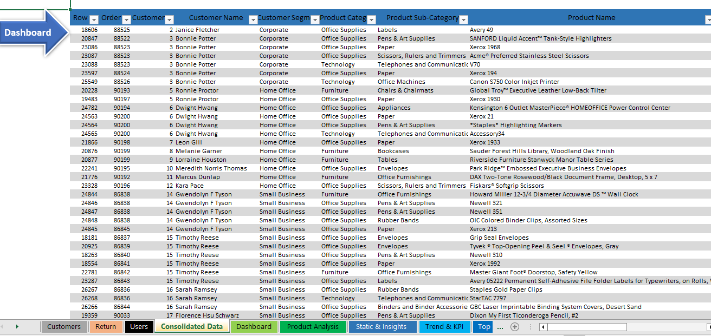
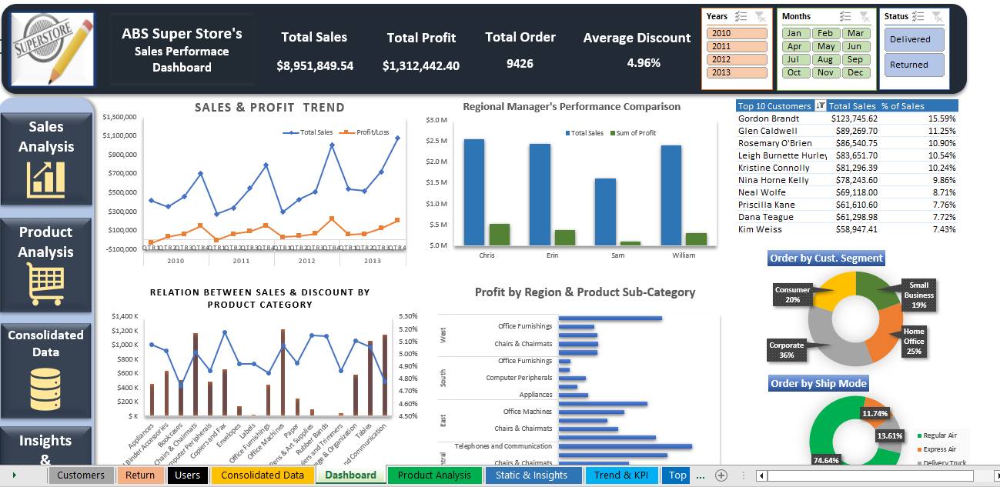
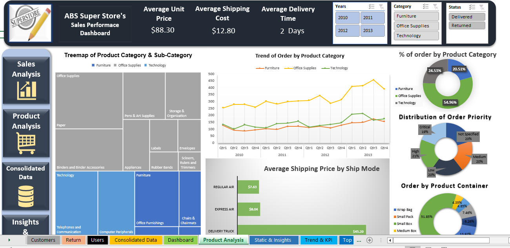

# Excel-Poject
## Super Store Sales Dashboard

This is a 4 years of a Super store sales data.
### Used Tools:
1. Power Query.
2. Merge.
3. Data cleaning.
4. Modeling.
5. Custom Column.
6. Conditional Column.
7. Pivot Table.
8. Math Function.
9. Different Charts.

### Process:
Firstly I take the data into power query of excel, Where I clean the data, do data modeling, use merge queries, append queries and load the data as a table format. Then I use some functions and most of the work is done by Pivot Table. Its a two sheet dashboard. First page for Sales Analysis and the other one for Product Analysis.

### Findings: 
### Consolidated data

### Sales Analysis

### Products Analysis

