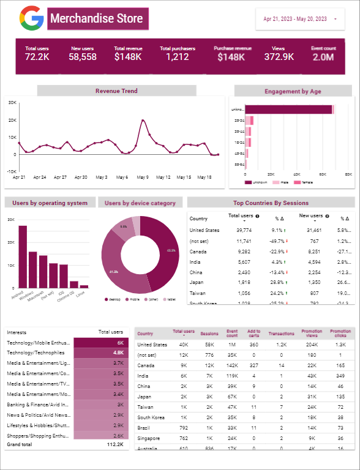
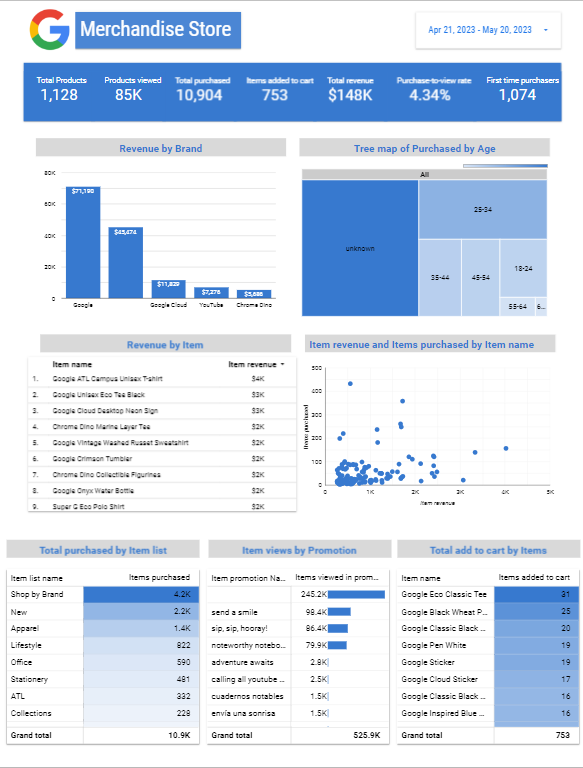
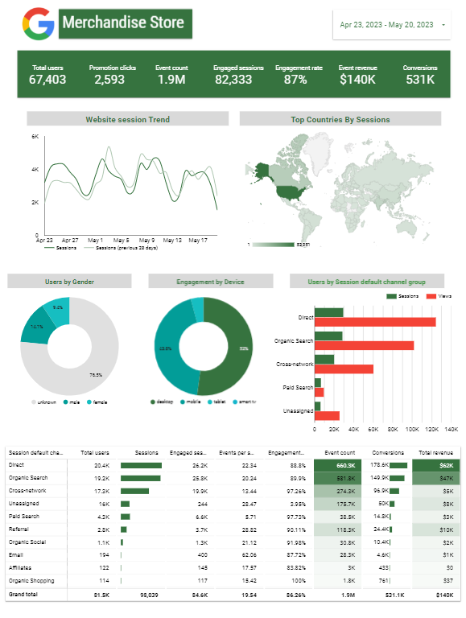

# Projects (GA4-LookerStudio)
### Google Merchandise Store Analysis

### Task perform:
* Playing with Google Locker Studio and Google Analytics-4  is fun. 
* This is a 3 page analysis of Google Merchandise Store. 
* I connect the data from GA4 with Locker Studio.
* I analyze and create the report in 3 sections. 
* First one is for the overall Summary. 
* Second one i focused on Products and the last section i analyze Website overview.
## You can see the report live here:
https://lookerstudio.google.com/reporting/00fab26e-4cee-462f-80fc-ef4d6aebf300

## Findings:
### Summary Page

### Products Page

### Website Page

